<div dir="rtl">

<div align="center">

# باجیمو

**پلتفرم بودجه رفاهی سازمانی**

سازمان بودجه ورزش و تفریح کارکنان را تعیین می‌کند، کارمند باشگاه، استخر یا سینما رزرو می‌کند<br>
و مجموعه با کد ورود مهمان را می‌پذیرد و تسویه دوره‌ای می‌گیرد.


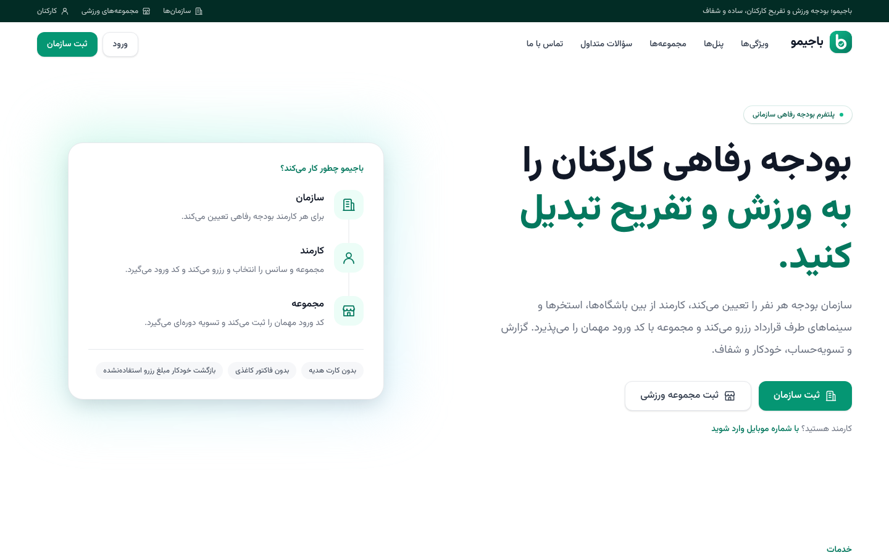

</div>

## فهرست

- [نمای برنامه](#نمای-برنامه)
- [پنل‌ها](#پنلها)
- [شروع سریع با Docker](#شروع-سریع-با-docker)
- [اجرای محلی](#اجرای-محلی)
- [به‌روزرسانی مکان‌ها از نقشه نشان](#بهروزرسانی-مکانها-از-نقشه-نشان)
- [صفحه‌های عمومی سایت](#صفحههای-عمومی-سایت)
- [ساختار](#ساختار)
- [کیفیت کد](#کیفیت-کد)

## نمای برنامه

همه تصاویر از داده نمونه (`make seed`) گرفته شده‌اند.

### پنل کارمند

بودجه باقی‌مانده، رزروهای پیش رو با کد ورود و پیشنهاد مجموعه‌ها در یک صفحه.

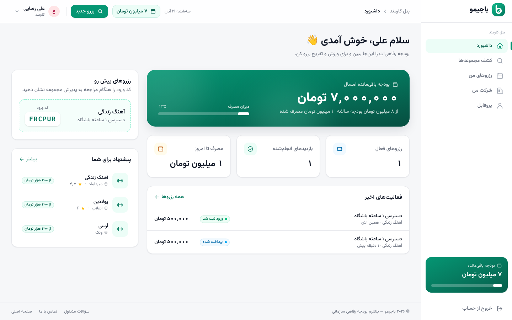

| کشف مجموعه‌ها (فهرست / نقشه) | رزروهای من |
| :---: | :---: |
| 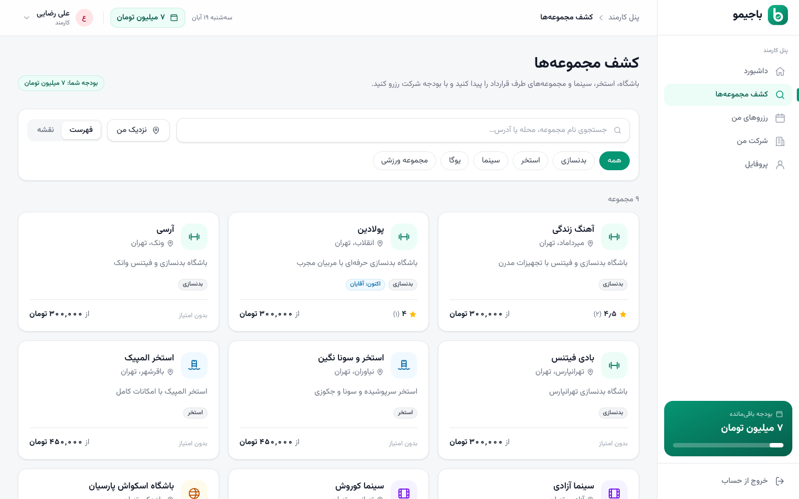 | 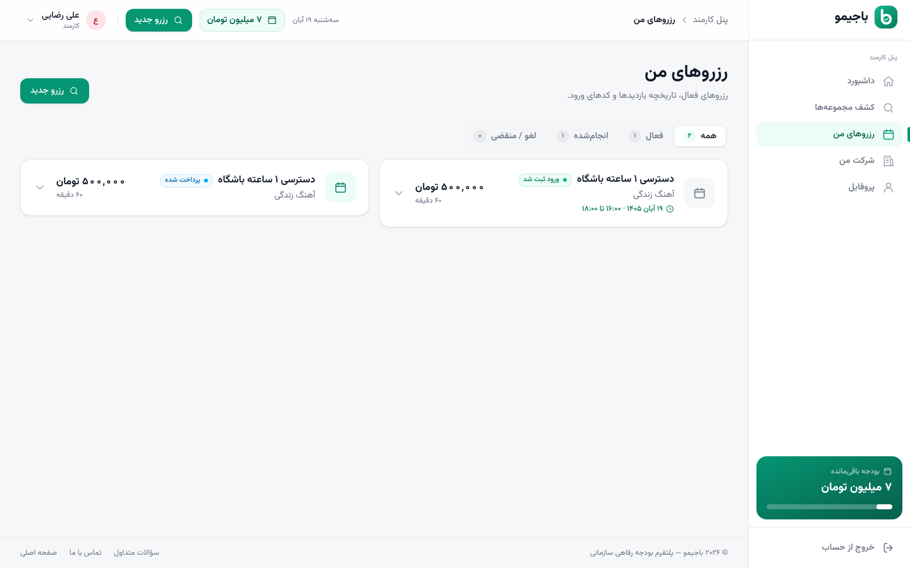 |

### پنل سازمان (منابع انسانی)

افزودن کارمند، تعیین بودجه، کارکنانی که بودجه‌شان رو به اتمام است و گزارش مصرف.

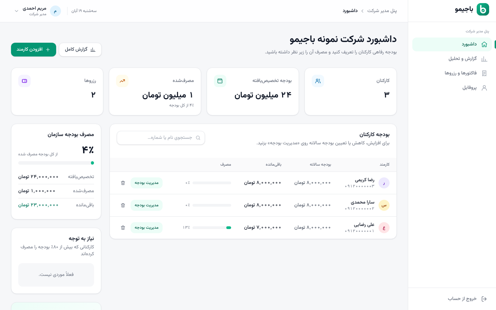

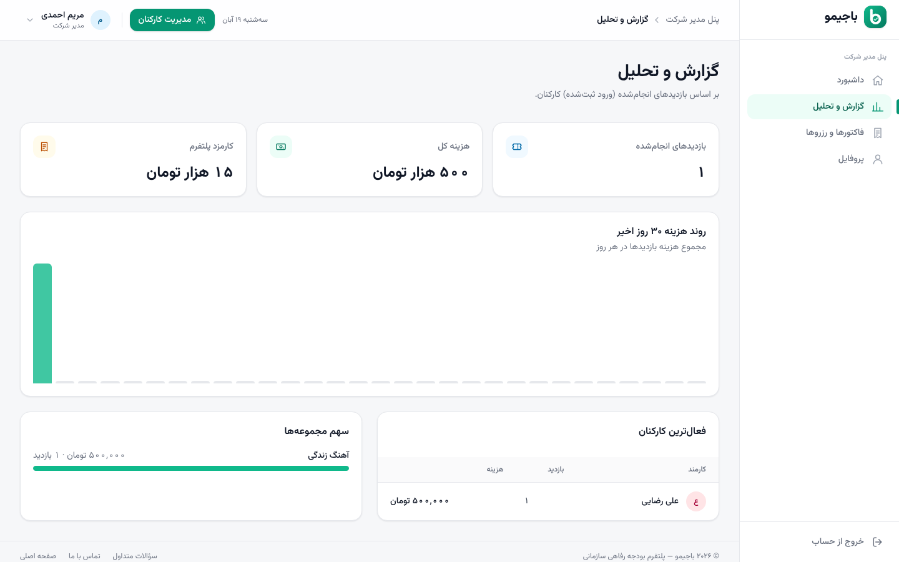

### پنل مجموعه

ثبت ورود مهمان با کد ۶ کاراکتری، تعریف خدمات و سانس‌ها و تسویه‌حساب.

| پذیرش و داشبورد | خدمات و سانس‌ها |
| :---: | :---: |
| 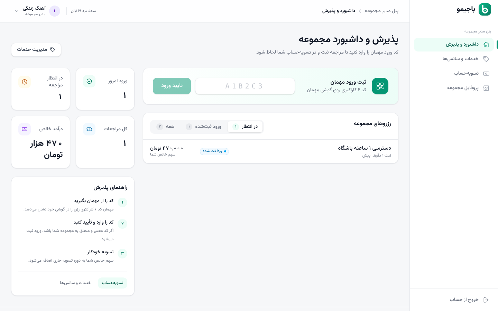 | 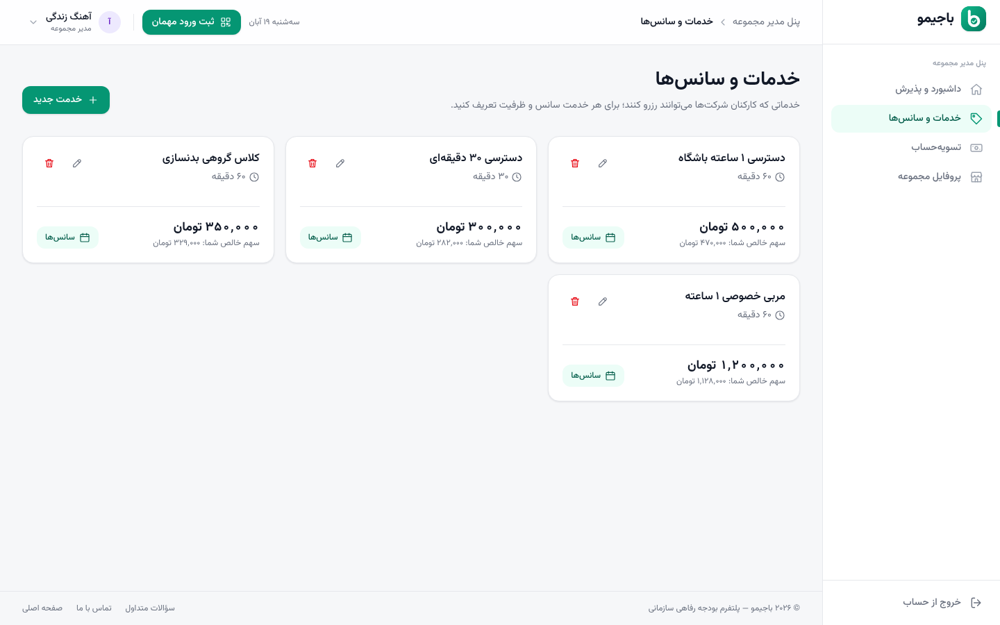 |

### مدیریت پلتفرم و ورود

| پنل مدیریت | ورود با کد پیامکی |
| :---: | :---: |
| 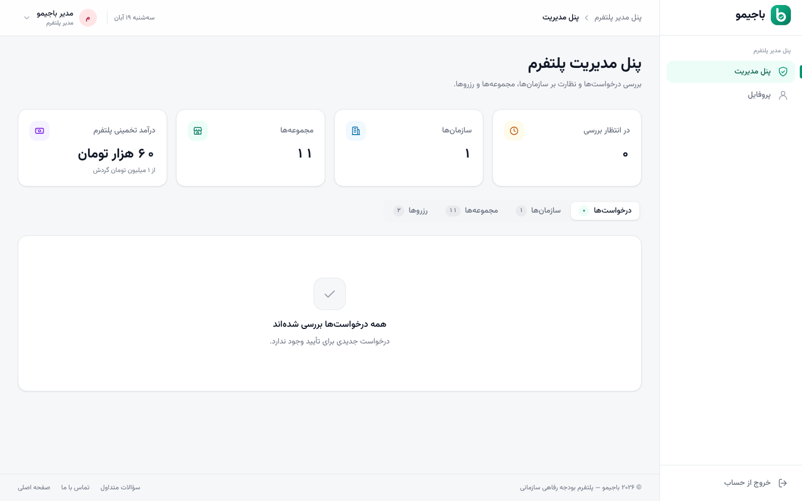 | 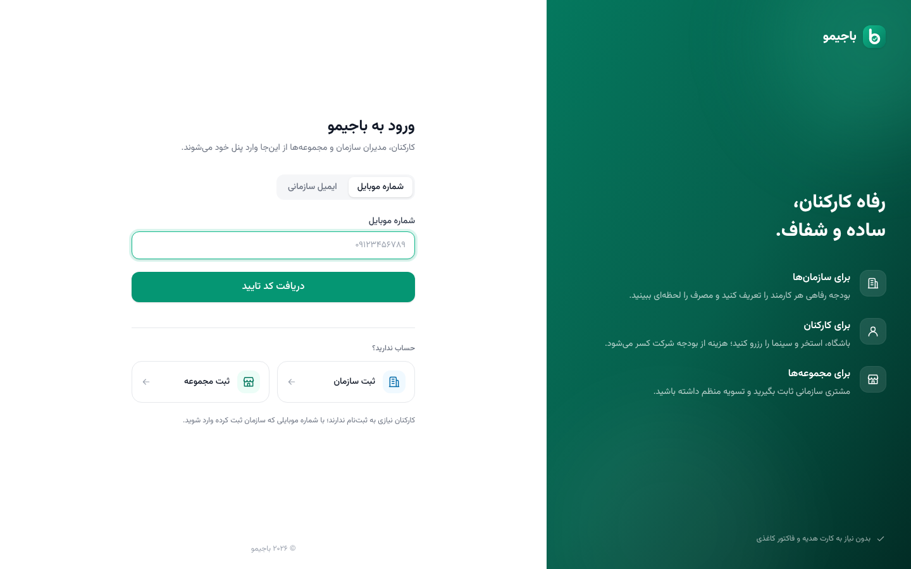 |

### صفحه‌های عمومی

| فهرست مجموعه‌ها | تماس با ما |
| :---: | :---: |
| 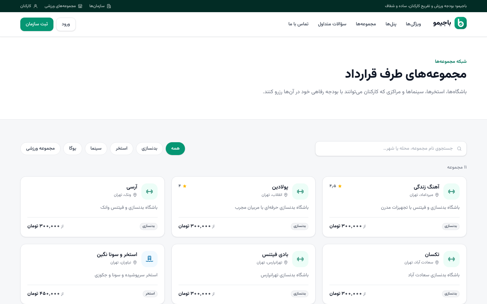 | 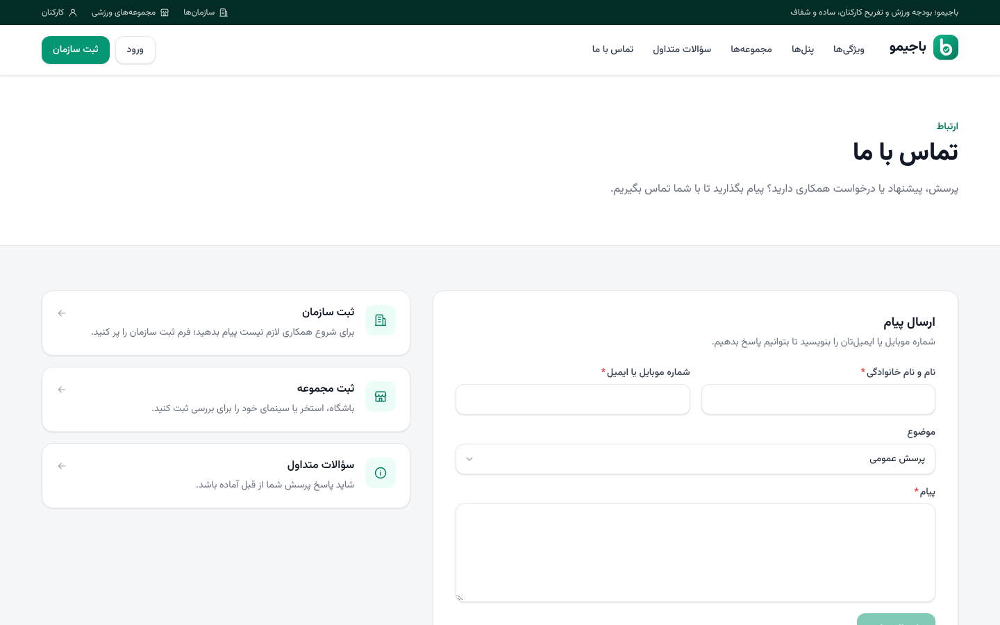 |

## پنل‌ها

| نقش | مسیر | کارها |
| --- | --- | --- |
| کارمند (`user`) | `/user/dashboard` | دیدن بودجه، کشف مجموعه‌ها (فهرست / نقشه)، رزرو سانس، کد ورود، لغو و بازگشت مبلغ، ثبت نظر |
| مدیر سازمان / منابع انسانی (`company_admin`, `company_hr`) | `/company/dashboard` | افزودن کارمند، تعیین/افزایش/کاهش بودجه، گزارش مصرف، فاکتورها و رزروها |
| مدیر مجموعه (`venue_staff`) | `/venue/dashboard` | ثبت ورود با کد، تعریف خدمات و سانس‌ها، تسویه‌حساب، پروفایل مجموعه |
| مدیر پلتفرم (`admin`) | `/admin` | تأیید/رد سازمان‌ها و مجموعه‌ها، نظارت بر رزروها |

**روند کار:** سازمان ثبت‌نام می‌کند و بودجه هر نفر را می‌گذارد ← کارمند با شماره موبایل وارد می‌شود و رزرو می‌کند ← مجموعه کد ورود را ثبت می‌کند ← مبلغ از بودجه کم و در دوره تسویه مجموعه محاسبه می‌شود.

## شروع سریع با Docker

```bash
cp .env.example .env
docker compose up --build -d      # postgres, redis, backend, celery-worker, celery-beat, frontend
docker compose exec backend python manage.py migrate
docker compose exec backend python manage.py seed_bagymo   # داده نمونه
```

فرانت روی <http://localhost:3000> و API روی <http://localhost:8000>. اگر هنگام ساخت به pypi.org دسترسی ندارید، راهنمای نصب آفلاین در `wheels/README.md` است.

## اجرای محلی

پیش‌نیاز: Python 3.12+، Node 20+، PostgreSQL و Redis (یا `docker compose up postgres redis`).

```bash
cp .env.example .env
make install-dev        # .venv + وابستگی‌های پایتون
make seed               # migrate + داده نمونه
make run-dev            # API روی :8000

make install-web        # در ترمینال دیگر
make run-web            # فرانت روی :3000
```

مایگریشن‌ها در یک نسخه اولیه (`0001_initial`) جمع شده‌اند؛ اگر دیتابیسی از نسخه‌های قبلی دارید آن را از نو بسازید (`docker compose down -v` یا حذف و ساخت دوباره دیتابیس) و بعد `make seed` بزنید.

بدون Postgres/Redis: در `.env` مقدار `DB_ENGINE=sqlite` و `REDIS_URL=` (خالی) را بگذارید.

در حالت توسعه (بدون `KAVENEGAR_API_KEY`) کد ورود پیامکی در کنسول سرور Django چاپ می‌شود.

### حساب‌های نمونه (بعد از `make seed`)

| نقش | ورود |
| --- | --- |
| کارمند | موبایل `09120000001` (کد OTP در کنسول) |
| مدیر سازمان | موبایل `09120000010` |
| مدیر مجموعه | موبایل `09120000081` |
| مدیر پلتفرم | موبایل `09120000000` |

## به‌روزرسانی مکان‌ها از نقشه نشان

باشگاه‌ها، استخرها، سینماها، یوگا و مجموعه‌های ورزشی را از سرویس جستجوی نشان (Search API نسخه ۳) می‌گیرد. مکان‌های جدید با وضعیت «در انتظار تأیید» ثبت می‌شوند و در پنل مدیریت (بخش درخواست‌ها، با برچسب «از نقشه نشان») تأییدشان می‌کنید. اجرای دوباره مکان تکراری نمی‌سازد، فقط مکان‌های هنوز تأییدنشده را به‌روز می‌کند و مکان تأییدشده را هیچ‌وقت بازنویسی نمی‌کند.

```bash
# در .env:  NESHAN_API_KEY=service.xxxxxxxx
python manage.py sync_neshan_venues                       # تهران، همه دسته‌ها
python manage.py sync_neshan_venues --city isfahan        # tehran, karaj, mashhad, isfahan, shiraz, tabriz, qom, ahvaz
python manage.py sync_neshan_venues --category gym --category pool
python manage.py sync_neshan_venues --dry-run             # فقط نمایش تغییرات
```

**کلید نشان:** در [پنل توسعه‌دهندگان نشان](https://platform.neshan.org/panel/api-key) یک کلید از نوع «سرویس‌ها» بسازید (با `service.` شروع می‌شود) و «دامنه‌های مجاز» آن را خالی بگذارید یا IP سرور را اضافه کنید. سرویس جستجو به‌طور پیش‌فرض در فهرست سرویس‌های کلید نیست و باید با ارسال تیکت (گروه «درخواست فعال‌سازی سرویس‌ها») از پشتیبانی نشان بخواهید فعالش کند.

| خطا | معنی |
| --- | --- |
| 480 | کلید نامعتبر است |
| 483 | نوع کلید اشتباه است (باید «سرویس‌ها» باشد، نه «نقشه وب») |
| 484 | IP سرور در «دامنه‌های مجاز» کلید نیست |
| 485 | سرویس جستجو روی کلید فعال نشده است |

نشان فقط نام، نشانی، محله و مختصات می‌دهد؛ امتیاز و نظر ندارد. امتیازها و نظرها را کارکنان در خود باجیمو ثبت می‌کنند.

**اجرای خودکار (Celery):** سرویس‌های `celery-worker` و `celery-beat` در `docker-compose.yml` هر شب ساعت ۳:۱۷ (وقت تهران) همگام‌سازی را برای `VENUE_SYNC_CITIES` اجرا می‌کنند. تنظیمات در `.env`: `VENUE_SYNC_CITIES=tehran,karaj`، `VENUE_SYNC_HOUR`، `VENUE_SYNC_GRID`، `VENUE_SYNC_ENABLED`. زمان‌بندی در ادمین جنگو (Periodic tasks) هم قابل ویرایش است.

بدون Docker:

```bash
CELERY_EAGER=false celery -A config worker -l info
CELERY_EAGER=false celery -A config beat -l info
```

## صفحه‌های عمومی سایت

| مسیر | محتوا |
| --- | --- |
| `/` | صفحه اصلی |
| `/venues` | فهرست مجموعه‌های فعال با جستجو و دسته‌بندی (بدون نیاز به ورود) |
| `/faq` | سؤالات متداول |
| `/contact` | فرم تماس؛ پیام‌ها در ادمین جنگو (Contact messages) دیده می‌شوند |
| `/terms`، `/privacy` | قوانین و مقررات، حریم خصوصی |

برای نمایش تلفن و ایمیل در صفحه تماس، هنگام بیلد فرانت `NEXT_PUBLIC_SUPPORT_PHONE` و `NEXT_PUBLIC_SUPPORT_EMAIL` را تنظیم کنید. متن قوانین و حریم خصوصی پیش‌نویس است و پیش از انتشار عمومی باید بازبینی حقوقی شود.

## ساختار

```
config/      تنظیمات Django، URLها، Celery
accounts/    کاربر، ورود OTP و ایمیل، پروفایل
companies/   API منابع انسانی (کارکنان، بودجه، داشبورد، ثبت سازمان)
catalog/     دسته‌بندی، سازمان، مجموعه، خدمت، سانس، امتیاز
bookings/    رزرو، لغو، انقضا، ثبت ورود
billing/     دفتر بودجه، کارمزد، تسویه مجموعه‌ها، فاکتور سازمان
budgets/     تاریخچه بودجه کارمند
core/        پیامک (کاوه‌نگار)، دسترسی‌ها، پیام‌های تماس با ما، دستورات مدیریتی (seed, reset_budgets)
tests/       pytest
web/         فرانت‌اند Next.js (App Router + Tailwind v4)
  src/components/ui   کتابخانه کامپوننت‌ها (Button, Card, Input, Modal, Table, Tabs, StatCard, Toast…)
  src/components/AppShell.tsx   چیدمان پنل: منوی کناری، نوار بالا و فوتر بر اساس نقش
  src/components/PageShell.tsx  کنترل ورود/دسترسی هر صفحه
  src/components/landing        هدر، فوتر و بخش‌های صفحه اصلی
docs/screenshots   تصاویر این راهنما
```

## کیفیت کد

```bash
make test     # pytest
make lint     # ruff + eslint + tsc
```

## نکات

- همه مبالغ به **تومان** ذخیره می‌شوند.
- سهم مجموعه هنگام تعریف خدمت ۹۴٪ قیمت است (۳٪ کارمزد از کارمند + ۳٪ از مجموعه؛ `DEFAULT_COMMISSION_PCT_*`).
- رزرو بدون سانس پس از `RESERVATION_TTL_MINUTES` و رزرو سانس‌دار پس از پایان سانس منقضی و مبلغ به بودجه برمی‌گردد.

</div>
